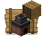

<p align="center">
  
</p>

<h1 align="center">Recipes Delight</h1>

<p align="center">
  A <a href="https://fabricmc.net/">Fabric</a> addon for
  <a href="https://modrinth.com/mod/farmers-delight-refabricated">Farmer's Delight Refabricated</a>
  that lets the Cooking Pot's recipe book see what's in the chests around it.
</p>

## What it does

By default, the Cooking Pot's recipe book only highlights a recipe as craftable if its ingredients
are in your inventory or already sitting in the pot. Recipes Delight extends that check to **nearby
chests and containers** (chests, trapped chests, barrels, shulker boxes, hoppers, droppers,
dispensers, furnaces, ...) within a configurable radius (4 blocks by default) around the pot.

## Configuration

The scan radius is stored in `config/recipes-delight.toml`:

```toml
# Recipes Delight configuration
# Radius (in blocks)
radius = 4
```

If [Cloth Config](https://modrinth.com/mod/cloth-config) and [Mod Menu](https://modrinth.com/mod/modmenu)
are installed, the radius can also be changed from Mod Menu's screen for this mod, Cloth Config is
only used as the in-game UI here; the value is still read from and written to the `.toml` file above,
never to Cloth Config's own storage.

## Bonus for Ecologics users !

If [Ecologics](https://modrinth.com/mod/ecologics) is installed, three extra cookies become
craftable at a crafting table:

| Item | Nutrition | Saturation | Recipe |
| --- | --- | --- | --- |
| Nuts Cookie | 2 | 0.1 | 2x Wheat + 1x Walnut |
| Chocolate & Nuts Cookie | 3 | 0.2 | 2x Wheat + 1x Cocoa Beans + 1x Walnut |
| Chocolate & Coconut Cookie | 3 | 0.2 | 2x Wheat + 1x Cocoa Beans + 1x Coconut Slice |

The Nuts Cookie matches the vanilla (cocoa-based) Cookie's nutrition exactly, just with a walnut
instead of cocoa beans. The other two are slightly more filling. None of these items or recipes exist
if Ecologics isn't present.

## Requirements

- Minecraft 26.3
- Fabric Loader
- Fabric API
- [Farmer's Delight Refabricated](https://modrinth.com/mod/farmers-delight-refabricated) 3.6.0+ (required)
- [Cloth Config](https://modrinth.com/mod/cloth-config) and [Mod Menu](https://modrinth.com/mod/modmenu) (for the config screen)
- [Ecologics](https://modrinth.com/mod/ecologics) (optional, unlocks the extra cookies)

## Building from source

Requires JDK 25.

```sh
./gradlew build    # outputs build/libs/
./gradlew runClient # launch a dev client with the mod loaded
```

## License

[MIT](LICENSE)
